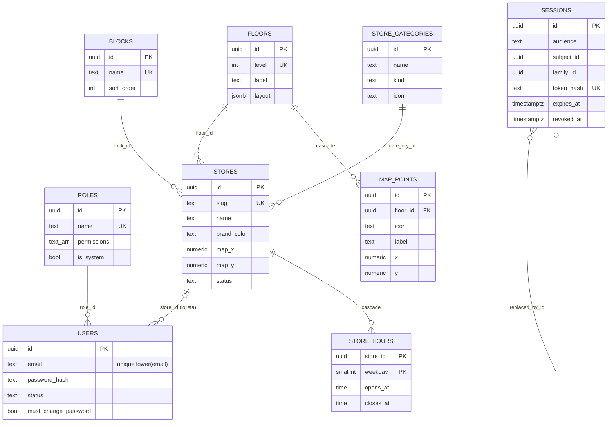
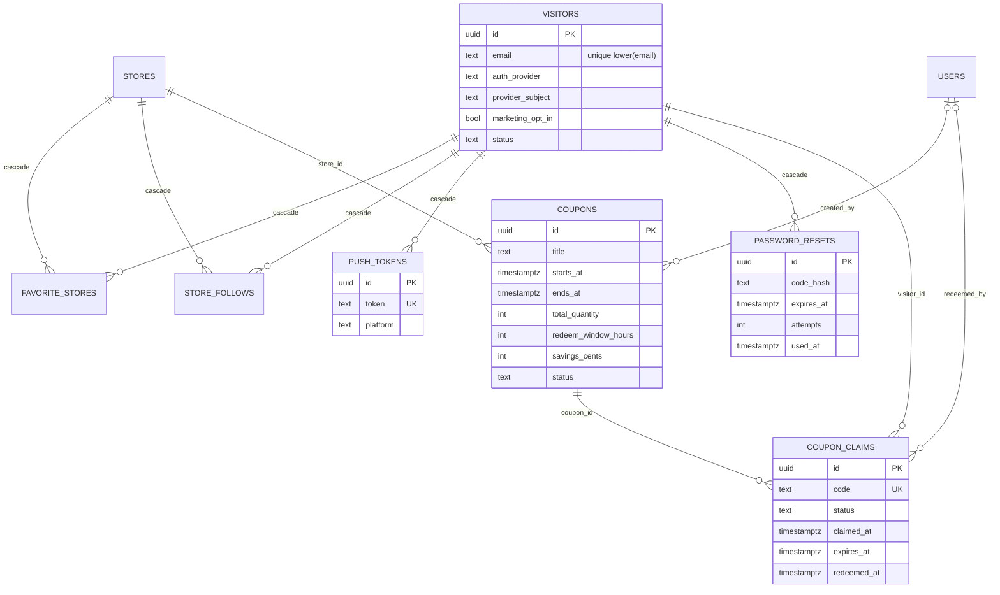
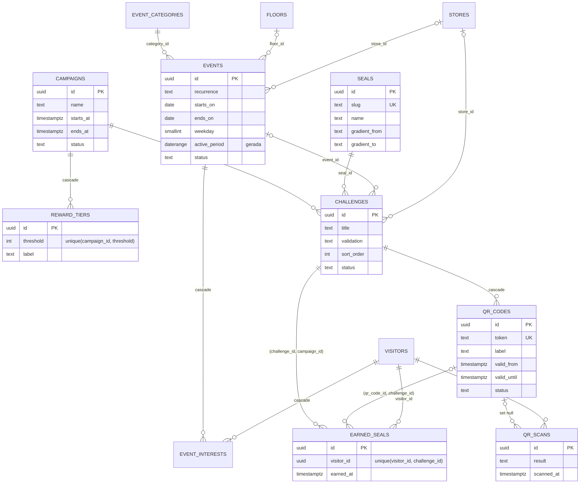
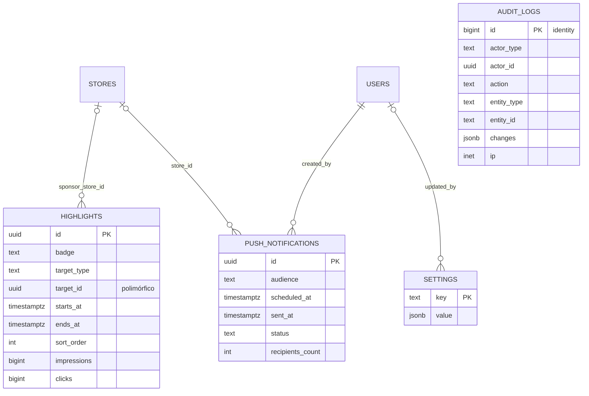

# Modelo de dados — ERP do App ARP

PostgreSQL do Supabase usado **só como armazenamento** (dados no Postgres,
imagens no Supabase Storage). Sem ORM: SQL à mão com `pg`, parametrizado pela
template tag `sql`. Auth, permissões e regras ficam na API — nada de Supabase
Auth, PostgREST, Edge Functions ou RLS por usuário.

- Migrations: `supabase/migrations/*.sql` (SQL puro, formato do Supabase CLI).
- Acesso: `apps/api/src/shared/infra/database/` (`Database`, `sql`, `migrate`, `seed`).
- Compatível com Postgres 15, 16 e 17 (Supabase). Em dev roda no Postgres 17 do Docker.

---

## 1. Schemas e tabelas

Um schema por domínio (mesmos nomes dos módulos da API):

| schema | tabelas |
|---|---|
| `identity` | `roles`, `users`, `sessions` |
| `directory` | `floors`, `blocks`, `store_categories`, `stores`, `store_hours`, `map_points` |
| `visitors` | `visitors`, `favorite_stores`, `store_follows`, `push_tokens`, `password_resets` |
| `promotions` | `coupons`, `coupon_claims` |
| `agenda` | `event_categories`, `events`, `event_interests` |
| `gamification` | `seals`, `campaigns`, `reward_tiers`, `challenges`, `qr_codes`, `earned_seals`, `qr_scans` |
| `marketing` | `highlights`, `push_notifications` |
| `platform` | `settings` |
| `audit` | `audit_logs` |
| `public` | só funções: `uuid_generate_v7()`, `f_unaccent(text)`, `set_updated_at()` |
| `extensions` | `pg_trgm`, `unaccent` |

### identity + directory



### visitors + promotions



### agenda + gamification



### marketing + platform + audit



---

## 2. Decisões

**`text` + `CHECK` em vez de enum nativo.** Acrescentar um valor num enum do
Postgres exige `ALTER TYPE` (que não roda em transação em versões antigas e
trava o tipo); trocar um CHECK é uma migration comum. O conjunto de valores
válidos é o mesmo dos `z.enum` do `@arp/contracts`.

**UUID v7 gerado no banco** (`public.uuid_generate_v7()`, plpgsql). Ids
ordenados no tempo: o índice da PK cresce sempre no fim (menos page split e
cache melhor que v4) e `order by id` ≈ ordem de criação. O Supabase ainda não
tem `uuidv7()` nativo (só no PG 18); quando tiver, basta trocar o default.
`audit_logs` usa `bigint identity` (só cresce, só é lido por data) e a API
serializa o id como string.

**Estoque de cupom derivado, nunca gravado.** Não existe coluna "restantes":
`restantes = total − (claims ativos com expires_at > now() + usados)`. Um
claim que vence sem uso devolve a unidade sozinho — sem job e sem contador que
possa dessincronizar. A concorrência do "pegar" é resolvida assim:

```sql
begin;
select id, total_quantity, status, starts_at, ends_at
  from promotions.coupons where id = $1 for update;      -- serializa só este cupom
select count(*) filter (where status = 'active' and expires_at > now())
     + count(*) filter (where status = 'redeemed') as taken
  from promotions.coupon_claims where coupon_id = $1;     -- index-only em coupon_claims_stock_idx
-- recusa se taken >= total_quantity (COUPON_SOLD_OUT)
insert into promotions.coupon_claims (...) values (...);  -- pode violar o unique parcial abaixo
commit;
```

O job de expiração só materializa `status = 'expired'` (para relatórios e
para liberar o unique parcial); a leitura já trata ativo vencido como devolvido.

**Unique parcial do claim ativo.** `coupon_claims_one_active_per_visitor`
(`unique (coupon_id, visitor_id) where status = 'active'`) garante "um ativo
por visitante por cupom" mesmo com dois cliques simultâneos, e ainda permite
pegar de novo depois de usar ou vencer. Violação → `COUPON_ALREADY_CLAIMED`.
Atenção: um claim ativo **vencido** ainda ocupa a vaga até o job marcá-lo
`expired`; no "pegar", a API deve expirar antes o ativo vencido do próprio
visitante (`update … set status = 'expired' where coupon_id = $1 and
visitor_id = $2 and status = 'active' and expires_at <= now()`).

**Selo uma vez por desafio** com `unique (visitor_id, challenge_id)`
(`earned_seals_visitor_challenge_key` → `SEAL_ALREADY_EARNED`). FKs compostas
garantem coerência: o selo aponta para `(challenge_id, campaign_id)` do
desafio e o QR lido para `(qr_code_id, challenge_id)`.

**Recorrência de eventos sem linhas por dia.** `single` (um dia), `range`
(período) e `weekly` (dia da semana, fim opcional), com CHECK de coerência
igual ao `recurrenceIssues()` do contrato. A coluna gerada `active_period
daterange` resolve o intervalo de cada evento (weekly sem fim = infinito) e um
índice GiST responde "o que acontece entre `from` e `to`"; a API expande os
dias (e filtra o `weekday` dos semanais) a partir disso.

**FKs `RESTRICT` por padrão**: nada que tem histórico é apagado (lojas,
cupons, usuários e visitantes são desativados/bloqueados). `CASCADE` só em
filhas puras: `store_hours`, `map_points`, `reward_tiers`, `qr_codes`,
favoritos, lojas seguidas, interesses, tokens de push. `qr_scans.qr_code_id`
é `SET NULL` (analytics sobrevive). `highlights.target_id` e
`sessions.subject_id` são polimórficos, sem FK (validados na API).

**`updated_at` por trigger** (`public.set_updated_at()`, `BEFORE UPDATE … WHEN
(old.* IS DISTINCT FROM new.*)`): update sem mudança não mexe na data. Exceção:
`agenda.events` (o Postgres não deixa o WHEN ler a coluna gerada).

**Auditoria só de inserção**: trigger em `audit.audit_logs` bloqueia
UPDATE/DELETE. Quando crescer, particionar por mês em `created_at`.

**Datas e fuso.** `timestamptz` para instantes (o `pg` devolve `Date`);
`date` para dias de calendário (devolvido como string `YYYY-MM-DD`, sem
fuso); `time` para horários locais. O negócio vive em `America/Sao_Paulo`:
sempre agrupe com `(col at time zone 'America/Sao_Paulo')::date`, nunca
dependa do fuso da sessão.

**Números.** Dinheiro em centavos (`integer`). O `Database` converte `int8`
(`count(*)`, `sum`) e `numeric` (médias, coordenadas `numeric(6,2)` do mapa)
para `number`; um `int8` acima de 2^53 lança erro em vez de arredondar (leia
com `::text`, como o id de `audit_logs`).

---

## 3. Índices e para que servem

Busca sem acento usa **sempre** a mesma expressão do índice:
`public.f_unaccent(lower(col)) like ${sql.containsPattern(q)}`.

| índice | consulta |
|---|---|
| `stores_name_trgm_idx`, `coupons_title_trgm_idx`, `events_title_trgm_idx`, `visitors_name_trgm_idx` (GIN trigram sobre `f_unaccent(lower(...))`) | busca `q` das listagens ("otica" acha "Ótica") |
| `visitors_email_trgm_idx` | busca por trecho do e-mail |
| `users_email_key`, `visitors_email_key` (`unique (lower(email))`) | login e unicidade sem diferenciar maiúsculas |
| `stores_status_name_idx` | listagem de lojas por status, ordenada por nome |
| `stores_category_id_idx`, `stores_block_id_idx`, `stores_floor_id_idx` | filtros da listagem, `storesCount`, "apagar sem lojas" |
| `coupons_store_id_status_idx` | cupons da loja, `activeCouponsCount`, painel do lojista |
| `coupons_status_period_idx` | vitrine do app (ativos no período), filtro por status |
| `coupon_claims_stock_idx (coupon_id, status, expires_at)` | **estoque** (cobre a consulta inteira), stock de várias promoções com `= any($ids)` |
| `coupon_claims_one_active_per_visitor` (unique parcial) | regra "um ativo por visitante" |
| `coupon_claims_active_expires_idx (expires_at) where status='active'` | job de expiração |
| `coupon_claims_visitor_claimed_idx (visitor_id, claimed_at desc)` | carteira do visitante, "últimos 20" do detalhe |
| `coupon_claims_claimed_at_idx` | dashboard: pegos por dia/período |
| `coupon_claims_redeemed_at_idx where redeemed_at is not null` | dashboard e lojista: usados por período/hora |
| `coupon_claims_code_key` | validação do código no caixa |
| `events_active_period_idx` (GiST) | calendário/ocorrências e filtro `from`/`to` |
| `events_status_dates_idx (status, starts_on, ends_on)` | listagem por status ordenada por data |
| `campaigns_status_period_idx` | campanha no ar |
| `earned_seals_campaign_visitor_idx` | progresso do visitante, participantes, faixas alcançadas |
| `earned_seals_earned_at_idx` | dashboard: selos por período |
| `earned_seals_challenge_id_idx`, `earned_seals_seal_id_idx` | `completionsCount`, `earnedCount`, "apagar desafio sem selos" |
| `qr_scans_qr_code_result_idx` | contagem por resultado de cada QR |
| `qr_scans_scanned_at_idx` | dashboard: `scanOutcomes` por período |
| `favorite_stores_store_id_idx`, `store_follows_store_id_idx` | `favoritesCount`/`followersCount`, público "seguidores da loja" |
| `visitors_created_at_idx` | listagem (recentes) e cadastros por período |
| `visitors_opted_in_idx` (parcial) | estimativa/envio do público `opted_in` |
| `highlights_status_period_idx` | carrossel no ar |
| `push_notifications_status_scheduled_idx` | job de disparo das agendadas |
| `sessions_subject_idx`, `sessions_family_id_idx`, `sessions_expires_at_idx` | logout geral, revogar família (reuso), limpeza |
| `audit_logs_entity_idx`, `audit_logs_actor_idx`, `audit_logs_created_at_idx`, `audit_logs_action_idx` | histórico da entidade, do usuário, geral e por ação |

Planos conferidos com `EXPLAIN ANALYZE` (200 mil claims, 20 mil lojas, 5 mil
eventos): todas as consultas acima usam o índice correspondente.

---

## 4. Constraints com nome (para traduzir erros)

`errors.ts` reconhece pelo nome: `isUniqueViolation(err, "users_email_key")`.

| constraint / índice | erro de domínio sugerido |
|---|---|
| `users_email_key`, `visitors_email_key` | e-mail já cadastrado (CONFLICT) |
| `visitors_provider_subject_key` | conta social já cadastrada (CONFLICT) |
| `roles_name_key`, `blocks_name_key`, `floors_level_key`, `store_categories_name_kind_key`, `stores_slug_key`, `seals_slug_key`, `event_categories_name_key` | nome/slug/nível já existe (CONFLICT) |
| `coupon_claims_one_active_per_visitor` | COUPON_ALREADY_CLAIMED |
| `coupon_claims_code_key` | colisão do código: gerar outro e repetir |
| `earned_seals_visitor_challenge_key` | SEAL_ALREADY_EARNED |
| `reward_tiers_campaign_threshold_key` | faixa repetida |
| `qr_codes_token_key` | colisão de token: gerar outro |
| `push_tokens_token_key` | upsert por token (troca de dono) |
| `sessions_token_hash_key` | colisão de hash (não acontece) |
| qualquer `*_fkey` em DELETE | "em uso" (ex.: apagar categoria com lojas) → CONFLICT |
| `*_check`, `*_range`, `*_format` | bug de validação (o Zod deveria ter barrado) → 500 com log |

---

## 5. Como acessar no código

```ts
const page = await db.many<StoreRow & { total: number }>(sql`
  select s.id, s.slug, s.name, count(*) over() as total
  from directory.stores s
  ${sql.where([
    query.status && sql`s.status = ${query.status}`,
    query.categoryId && sql`s.category_id = ${query.categoryId}`,
    query.q && sql`public.f_unaccent(lower(s.name)) like ${sql.containsPattern(query.q)}`,
  ])}
  order by s.name
  limit ${query.pageSize} offset ${(query.page - 1) * query.pageSize}
`);

await db.transaction(async () => {
  await couponRepository.save(coupon);   // usa db.query: mesmo client da transação
  await auditLogger.log({ ... });        // idem
});
```

- Nunca `select *` em produção; colunas explícitas.
- Não paralelize consultas (`Promise.all`) dentro de uma transação.
- Transação aninhada vira SAVEPOINT (falha interna não derruba a externa se for tratada).

---

## 6. Migrations

**Criar uma nova**: arquivo `supabase/migrations/<AAAAMMDDHHMMSS>_<nome_snake>.sql`
com versão maior que a última (ou `supabase migration new <nome>`). Regras:

- Nunca edite uma migration já aplicada (o runner avisa se o conteúdo mudar);
  mudança = migration nova.
- Sem `begin`/`commit` no arquivo: o runner já envolve cada arquivo numa transação.
- Sem `create index concurrently` (não roda em transação). Para tabela grande
  em produção, crie o índice à mão fora do horário e registre a migration.
- Tabela nova: PK `uuid default public.uuid_generate_v7()`, `created_at`/
  `updated_at` com trigger `set_updated_at`, CHECKs de status, índices nas FKs
  consultadas, `comment on` no que não for óbvio e
  `alter table … enable row level security` (os grants para anon/authenticated
  já nascem revogados pelos default privileges).

**Aplicar**: `npm run db:migrate -w @arp/api` (e a API chama
`runMigrations(db, dir)` na subida). Cada arquivo roda numa transação e é
registrado em `supabase_migrations.schema_migrations (version, statements,
name)` — a mesma tabela do Supabase CLI. Um `pg_advisory_lock` impede duas
réplicas de migrarem juntas (a segunda espera e não acha nada pendente).
`npm run db:migrate -w @arp/api -- --status` lista aplicadas/pendentes.

**No Supabase**:

1. Use a connection string do **pooler em modo session** (porta 5432,
   `postgres.<ref>@aws-0-<regiao>.pooler.supabase.com`) ou a conexão direta.
   O modo transaction (6543) não serve: advisory locks e prepared statements
   precisam de sessão fixa.
2. `DB_SSL=auto` liga SSL (sem validar a cadeia, como `sslmode=require`); para
   validar, baixe o certificado no painel e use `DB_SSL=verify` + `DB_SSL_CA`.
3. `supabase db push` é compatível: o CLI lê a mesma tabela de histórico e só
   aplica o que faltar (e vice-versa). Os schemas `extensions` e
   `supabase_migrations` já existem lá; as migrations usam `if not exists`.
4. Não exponha os nossos schemas em *API settings → Exposed schemas*. Mesmo se
   expuser, RLS sem políticas + `revoke` deixam anon/authenticated sem acesso.
   As três funções do `public` continuam executáveis via `PUBLIC` (padrão do
   Postgres): são puras e não leem dados.

---

## 7. Desenvolvimento local

```bash
docker compose --profile local up -d db   # Postgres 17 em 127.0.0.1:5433
npm run db:migrate -w @arp/api
npm run db:seed -w @arp/api               # exige SEED_ADMIN_PASSWORD
```

---

## 8. Seed

`npm run db:seed -w @arp/api` (ou `runSeed({ db }, { adminPassword })`).

- **Idempotente**: insere o que falta pela chave natural e **não sobrescreve**
  o que foi editado no painel — seguro com `SEED_ON_START`. Senha só na
  criação do usuário. O cargo do sistema (Administrador) é sincronizado com
  todas as `PERMISSIONS` do contrato.
- **Dados reais do site da ARP** (`seed/site-data.ts`, gerado do espacoarp.com.br
  em 2026-11): 188 lojas com foto de capa, horários, contatos e categorias; os
  blocos; os 41 pontos do Circuito Cultural; história, regras e configurações
  (contato, estacionamento, tour). As lojas entram **uma vez só**: loja apagada
  no painel não volta na próxima subida.
- Eventos não vêm do seed: use "Importar do site" na agenda.
- Não há mais dados fictícios (cupons, desafios, visitantes). Um banco que
  ainda tenha o catálogo de demonstração antigo é limpo na primeira execução
  (`seed/legacy-demo.ts`).
- Usuário criado: `admin@arp.com.br` (Administrador), senha = `SEED_ADMIN_PASSWORD`.
